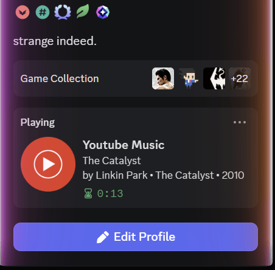

##### YouTube Music Discord RPC

##### Overview

##### 

##### This project syncs your YouTube Music playback directly to your Discord status through a Node.js bridge and a Firefox browser extension.

##### Core Features

##### 

##### The system performs live synchronization of song titles, artist names, and high-resolution album artwork. Clicking the song title in Discord opens the current song on YouTube Music. Discord's activity timestamps provide an elapsed/total timer and progress bar while music plays. The album cover is shown as the large activity image with the YouTube Music logo overlaid as the small image. If artwork is unavailable or Discord cannot use its external URL, the YouTube Music logo is used as the large image. The activity is cleared while music is paused to prevent Discord from displaying its own elapsed activity timer, then restored when playback resumes.

##### Node.js Setup

##### 

For development, install Node.js, run `npm install` from the repository root, and start the bridge with `node server.js`.

##### Firefox Installation

##### 

##### Navigate to the about:debugging page in your browser. Click on the This Firefox option in the sidebar. Select the Load Temporary Add-on button and choose the manifest.json file from your project folder.

##### Windows Installer

##### 

The Windows installer bundles the bridge, its production dependencies, and Node.js; users do not need to install Node.js or run npm. Discord Desktop and the Firefox add-on are still required and installed separately. The bridge retries its Discord connection if Discord is still starting.

To build the installer from source on 64-bit Windows, install Node.js 24 and Inno Setup 6, then run `npm run build:installer`. The setup executable is written to the `dist` folder. The GitHub Actions workflow also builds the installer when manually run or when a `bridge-v*` tag is pushed; download its artifact from the workflow run. The build creates a clean staging package whose name and version match the committed lockfile, then installs production dependencies from that lockfile using `npm ci` for a repeatable build.

The installer can launch the bridge when setup finishes, adds a Start Menu shortcut and uninstaller, and lets users optionally enable automatic startup at Windows sign-in. The Firefox extension is not included.

##### Requirements

##### 

Discord Desktop must be installed and running, and Activity Status must be enabled in Discord. Node.js is needed only to run the bridge from source or build the installer; it is bundled in the installer.

