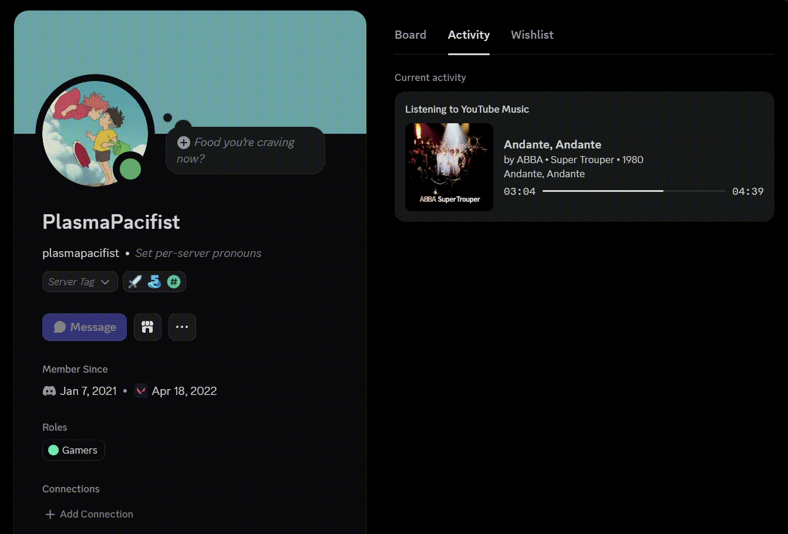
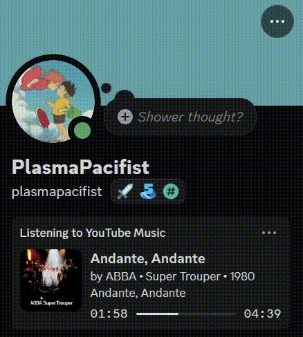

# YouTube Music Discord Presence

Show your current YouTube Music song, artist, album art, and playback progress in your Discord status.

## Demo

## Setup

1. Download and run the Windows `.exe` from [Releases](https://github.com/AryaKenway/Discord-Rich-Presence-YTMusic/releases).
2. Install the [Firefox extension](https://addons.mozilla.org/en-US/firefox/addon/ytmdiscordbridge/).
3. Open Discord and YouTube Music in Firefox, then play a song.
